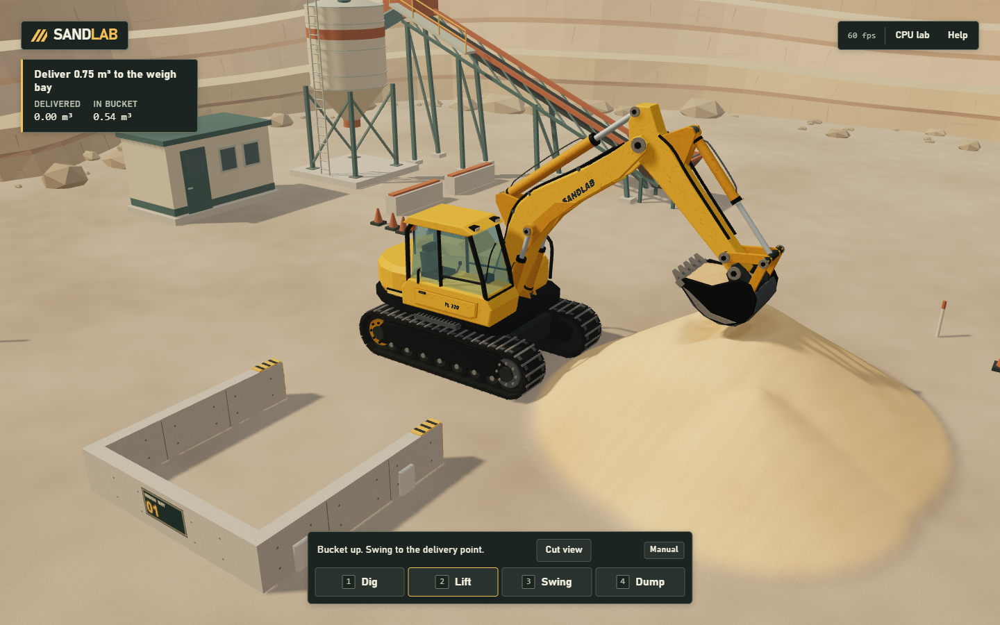

# SandLab

Drive a tracked excavator in a small working quarry. Curl the bucket into the bank, lift a load, swing over the concrete bay, and watch where the sand actually lands. Spills stay in the yard. Take the second order to build a stockpile within a marked footprint, then keep the controls in free dig.

**[Play SandLab on GitHub Pages](https://tront.xyz/sand/)** · [Download the standalone HTML](https://github.com/TrentSterling/sand/raw/refs/heads/main/index.html)

[Compare the original and revised excavator from 15 angles](https://tront.xyz/sand/review/) · [Read the blind reviews and mechanical results](GAUNTLET.md)



## In the operator seat

| Control | Action |
| --- | --- |
| **1, 2, 3, 4** or the four on-screen buttons | Dig, lift, swing to the current delivery point, dump. Each button runs the articulated machine through a movement. The soil solver decides how much it picks up and where it lands. |
| **W / S**, **E / D**, **R / F** | Raise / lower boom, extend / draw the stick, curl / tip the bucket. The first joint input switches to manual. |
| **Q / A**, **arrow keys** | Slew the upper house, or drive and steer the tracks. |
| **Double-click terrain** | Position the cutting edge at a reachable point using two-link inverse kinematics. |
| **Cut view** | Look across the pin axes and drag the teeth through the bank with a mouse or finger. Hold R or F to adjust the bucket pitch while dragging. The cursor changes colour when the teeth fall short. |
| **Drag / scroll or pinch** | Orbit and zoom. The manual panel also has hold controls for touch. |
| **CPU lab** | Pause, single-step, show awake terrain tiles, or replay the same inputs through two CPU schedulers. |
| **Help** | Toggle engine sound, reset the quarry, or save the one-file offline build. |

The first order weighs 0.75 m³ of delivered sand. The second calls for 1.50 m³ inside the stockpile ring. Both count material that actually reaches the destination. Volumes are reported as their loose-sand equivalents so compacting a pile under the tracks cannot change the score.

## What moves the sand

The Rust core owns a 32 × 32 m yard at 125 mm spacing. Columns store integer quantities of dry sand plus compaction. A curl or inward stroke loads the bucket to a heaped capacity of 0.55 m³. Once full, the blade moves soil sideways across both cheeks. The bucket retains its load through steady transport. Tipping or accelerating it can release material. A parcel's mass, velocity and impact location drive the visible discharge and the resulting deposit. A darker cut face shows where the teeth removed the original bank. Each column has one surface, so a persistent overhang would need a different representation.

The solver advances at 60 fixed steps per second on one CPU thread. Four alternating disjoint-neighbor passes cover both grid axes. A 16 × 16 tile wakes when material changes and stays awake long enough to cover the neighboring pairs. The renderer uploads only the affected position and normal ranges and reuses its shadow map while the machine and ground are still. WebGL2 draws the result. No compute shaders are required.

### Measure a dig

The lab compares the first minute of your recorded tool and drive inputs, a repeatable reference dig, or a quarry-wide avalanche. Both schedulers start from the same initial conditions. The panel reports elapsed simulation time, pair visits, mass balance and whether the final material-state hashes agree. The avalanche keeps much more of the yard active and gives a different performance comparison.

On an Intel Core Ultra 9 285K under Windows, 21 paired repetitions of the 720-tick reference dig gave the following results. Times cover the complete native replay loop. World creation, rendering, and validation are outside the timer. [Native benchmark receipt](evidence/native.json)

| Scheduler | Median per replay | p95 per replay | Neighbor pairs visited |
| --- | ---: | ---: | ---: |
| Active tiles | 0.742 ms | 0.762 ms | 217,088 |
| Full grid | 32.473 ms | 33.727 ms | 23,500,800 |

Both runs ended with material hash `92c38cf6` and zero mass error. In Chrome at 1440 × 900 on an RTX 5070 Ti, the playtest measured 16.7 ms median and 16.8 ms p95 between animation frames. The browser's quarry-wide avalanche took 20.3 ms with active tiles and 38.2 ms with a full scan over the complete 360-tick replay. The final material states matched. [Browser playtest and timing receipt](evidence/browser.json)

## The excavator

The machine is an original parametric model. Its house, boom, stick, toothed bucket and track assemblies are grouped around their mechanical pivots. Four telescoping cylinders resolve between attachment points. A pin-jointed four-bar linkage connects the crowd cylinder to the bucket. The same tooth transform drives the excavation solver. Static surfaces are batched by finish and joint. The track shoes are instanced. [Editable machine source](web/machine.js)

The boom and dipper are extruded steel profiles. The bucket shell, side plates, tooth faces, fork and cylinder eyes have editable cross-sections and local pin coordinates. The authoring inputs are hand-set Three.js geometry and dimensions. AnyMachine informed the part decomposition. The img2threejs workflow informed the fixed-view visual checks. Production machines provided proportion and working-motion references. The exact linkage dimensions and cylinder stops are original to this game. [AnyMachine](https://github.com/apekshik/anymachine) · [img2threejs](https://github.com/img2threejs/img2threejs) · [Caterpillar digging and trenching reference](https://www.cat.com/en_US/articles/for-owners/tips-for-digging-and-trenching-with-your-excavator.html)

Validation covers 1,485 forward poses, 2,288 reachable tooth targets through the game's actual IK, 80 constrained target cases, 2,048 stroke intervals per actuator joint, and 21 isolated model renders. The crawler seats on 18 terrain samples. Load transfer, hydraulic pressure and traction dynamics remain approximations. [Rig checks](evidence/rig.json) · [IK and support checks](evidence/controls.json) · [Draw-order audit](evidence/surface-audit.json)

## Run and build

Open `index.html` directly in a WebGL2 and WebAssembly browser. The release embeds the simulation, renderer, machine and scenery. It also runs with the network disabled. The Three.js license is included in the HTML.

Rebuild with Rust, Node.js and npm from the repository root.

```sh
rustup target add wasm32-unknown-unknown
npm ci
npm run build
```

Run the native simulation and kinematic checks with the following commands.

```sh
cargo test --locked --release
cargo run --locked --release --bin bench
node tools/verify-machine.mjs
node tools/verify-controls.mjs
```

For browser verification, install Python Playwright and Chrome. Run `python tools/playtest.py` to complete both jobs, compare the solvers and open the downloaded build with network requests blocked. Run `python -m playwright install chromium` and `python tools/inspect-machine.py` for the orthographic model review.
