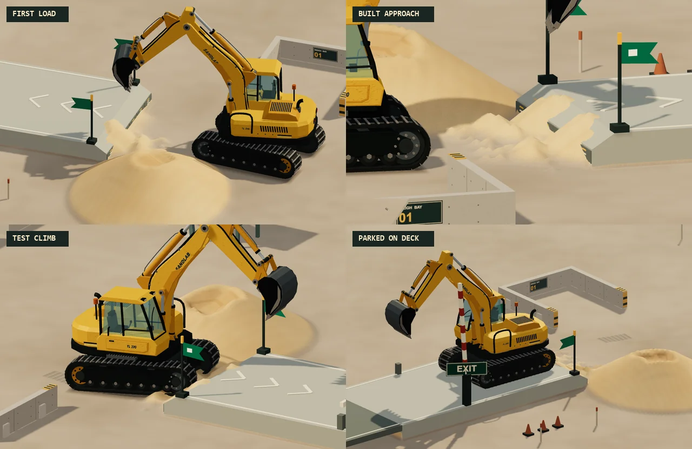

# SandLab

The exit deck stands just above the excavator's tracks. Take a bite out of the bank, pour sand against the concrete lip, and try driving up what you built. The gate lifts when both tracks are on the deck and the machine comes to a stop.

**[Play Build Your Way Out on GitHub Pages](https://tront.xyz/sand/)** · [Open the quarry orders](https://tront.xyz/sand/?yard=quarry) · [Download the standalone HTML](https://github.com/TrentSterling/sand/raw/refs/heads/main/index.html)

[Watch the driving crest test](https://tront.xyz/sand/review/drive/) · [Compare the original and revised excavator from 15 angles](https://tront.xyz/sand/review/) · [Read the blind reviews and mechanical results](GAUNTLET.md)



## Build your way out

Tap a spot on the bank to cut there. With sand in the bucket, tap the spot where you want to pour. **Half pour** keeps some sand in the bucket for a second placement. The two gauges show how much sand is supporting each approach at the lip. If you stall, back up and look for the orange cross where the low track needs help.

Hold **Drive to exit** to line up with the deck, or steer the tracks yourself. Your browser remembers the fewest scoops you escaped with. A faster run breaks a tie.

## In the operator seat

| Control | Action |
| --- | --- |
| **1, 2, 3** in the escape job | Scoop at the bank or place at the left or right track approach. Tap the ground for a custom cut or pour. |
| **1, 2, 3, 4** in quarry orders | Dig, lift, swing to the delivery point, dump. The soil solver decides how much the bucket picks up and where it lands. |
| **W / S**, **E / D**, **R / F** | Raise / lower boom, extend / draw the stick, curl / tip the bucket. The first joint input switches to manual. |
| **Q / A**, **arrow keys** | Slew the upper house, or drive and steer the tracks. |
| **Double-click terrain in manual** | Position the cutting edge at a reachable point using two-link inverse kinematics. |
| **Cut view** | Look across the pin axes and drag the teeth through the bank with a mouse or finger. Hold R or F to adjust the bucket pitch while dragging. The cursor changes colour when the teeth fall short. |
| **Drag / scroll or pinch** | Orbit and zoom. The manual panel also has hold controls for touch. |
| **CPU lab** | Pause, single-step, show track forces and centre of mass, show awake terrain tiles, or replay the same inputs through two CPU schedulers. |
| **Help** | Toggle engine sound, reset the quarry, or save the one-file offline build. |

Open **Help → Quarry orders** for the original yard. The first order weighs 0.75 m³ of delivered sand. The second calls for 1.50 m³ inside the stockpile ring, then unlocks free dig. Both count material that reaches the destination. Volumes are reported as loose-sand equivalents so compacting a pile under the tracks cannot change the score.

## Driving the crawler

Raise the boom with **W**, drive up the bank with **↑**, release to brake, then slew with **Q**. The 20.4 t carrier carries its velocity into the stop. The house, counterweight, boom, stick, bucket and payload determine how the two tracks share its weight. A heaped bucket adds 880 kg at the attachment. The raised arm can rock the chassis, and pressing the bucket into hard ground can lift weight off the tracks.

Each track drives and brakes independently. Loaded shoes compress loose sand and can push material sideways into ruts. The CPU integrates the chassis at 120 Hz and the soil at 60 Hz. The machine uses a rigid undercarriage, a prescribed hydraulic linkage and a dry granular heightfield. The masses, drive characteristics and soil coefficients are game calibrations. [Physics source](web/crawler.js) · [Crest films and six matched views](https://tront.xyz/sand/review/drive/) · [Drive test measurements](evidence/drive.json)

## What moves the sand

The Rust core owns a 32 × 32 m yard at 125 mm spacing. Columns store integer quantities of dry sand plus compaction. A curl or inward stroke loads the bucket to a heaped capacity of 0.55 m³. Once full, the blade moves soil sideways across both cheeks. The bucket retains its load through steady transport. Tipping or accelerating it can release material. A parcel's mass, velocity and impact location drive the visible discharge and the resulting deposit. A darker cut face shows where the teeth removed the original bank. Each column has one surface, so a persistent overhang would need a different representation.

The solver advances at 60 fixed steps per second on one CPU thread. Four alternating disjoint-neighbor passes cover both grid axes. A 16 × 16 tile wakes when material changes and stays awake long enough to cover the neighboring pairs. The renderer uploads only the affected position and normal ranges and reuses its shadow map while the machine and ground are still. WebGL2 draws the result. No compute shaders are required.

### Measure a dig

The lab compares the first minute of your recorded tool and drive inputs, a repeatable reference dig, or a quarry-wide avalanche. Both schedulers start from the same initial conditions. The panel reports elapsed simulation time, pair visits, mass balance and whether the final material-state hashes agree. The avalanche keeps much more of the yard active and gives a different performance comparison.

On an Intel Core Ultra 9 285K under Windows, 21 paired repetitions of the 720-tick reference dig gave the following results. Times cover the complete native replay loop. World creation, rendering, and validation are outside the timer. [Native benchmark receipt](evidence/native.json)

| Scheduler | Median per replay | p95 per replay | Neighbor pairs visited |
| --- | ---: | ---: | ---: |
| Active tiles | 0.742 ms | 0.762 ms | 217,088 |
| Full grid | 32.473 ms | 33.727 ms | 23,500,800 |

Both runs ended with material hash `92c38cf6` and zero mass error. In Chrome at 1440 × 900 on an RTX 5070 Ti, the playtest measured 16.7 ms median and 16.8 ms p95 between animation frames. The browser's quarry-wide avalanche took 20.3 ms with active tiles and 37.8 ms with a full scan over the complete 360-tick replay. The final material states matched. [Browser playtest and timing receipt](evidence/browser.json)

## The excavator

The machine is an original parametric model. Its house, boom, stick, toothed bucket and track assemblies are grouped around their mechanical pivots. Four telescoping cylinders resolve between attachment points. A pin-jointed four-bar linkage connects the crowd cylinder to the bucket. The same tooth transform drives the excavation solver. Static surfaces are batched by finish and joint. The track shoes are instanced. [Editable machine source](web/machine.js)

The boom and dipper are extruded steel profiles. The bucket shell, side plates, tooth faces, fork and cylinder eyes have editable cross-sections and local pin coordinates. The authoring inputs are hand-set Three.js geometry and dimensions. AnyMachine informed the part decomposition. The img2threejs workflow informed the fixed-view visual checks. Production machines provided proportion and working-motion references. The exact linkage dimensions and cylinder stops are original to this game. [AnyMachine](https://github.com/apekshik/anymachine) · [img2threejs](https://github.com/img2threejs/img2threejs) · [Caterpillar digging and trenching reference](https://www.cat.com/en_US/articles/for-owners/tips-for-digging-and-trenching-with-your-excavator.html)

Validation covers 1,485 forward poses, 2,288 reachable tooth targets through the game's actual IK, 80 constrained target cases, 2,048 stroke intervals per actuator joint, and 21 isolated model renders. The driving gauntlet separately exercises free fall, braking, a ledge drop, bank traversal, cross-slope load transfer, bucket jacking and a parked crest reversal. [Rig checks](evidence/rig.json) · [IK checks](evidence/controls.json) · [Draw-order audit](evidence/surface-audit.json)

## Run and build

Open `index.html` directly in a WebGL2 and WebAssembly browser. The release embeds the simulation, renderer, machine and scenery. It also runs with the network disabled. The Three.js license is included in the HTML.

Rebuild with Rust, Node.js and npm from the repository root.

```sh
rustup target add wasm32-unknown-unknown
npm ci
npm run build
```

Run the native simulation and kinematic checks with the following commands.

```sh
cargo test --locked --release
cargo run --locked --release --bin bench
node tools/verify-machine.mjs
node tools/verify-controls.mjs
node tools/verify-drive.mjs
```

For browser verification, install Python Playwright and its Chromium browser. Run `python tools/escape-playtest.py` for a mouse and keyboard escape, a metered two-spot pour, a retry and a saved best. Add `--touch` to drive using a phone-sized touch viewport. Run `node tools/gauntlet-build.mjs candidate` followed by `python tools/escape-gauntlet.py` for the matched zero-, one-, two- and four-load approaches. [Drive comparison](evidence/escape.json)

Run `python tools/playtest.py --channel chromium` to complete both quarry orders, compare the solvers and open the downloaded build with network requests blocked. Run `python tools/drive-playtest.py` with Chrome for the keyboard crest test. Run `python tools/inspect-machine.py` for the orthographic model review.
